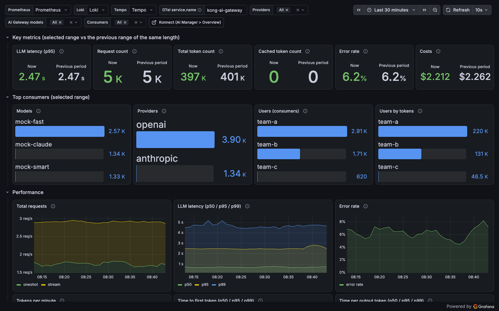
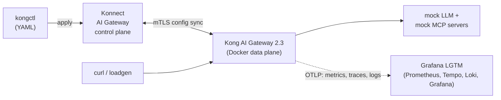

# Kong AI Gateway observability workshop

Send **metrics, traces and logs** from a Kong AI Gateway 2.3 data plane to a **Grafana LGTM** stack with the
**OpenTelemetry policy**, and monitor it with a Grafana dashboard modelled on the Konnect AI Manager overview page.



_Screenshot from this workshop. The numbers come from mock backends and generated traffic, not real usage. [Full dashboard](docs/images/dashboard-full.png)._



**Full architecture, flows and design notes: [docs/architecture.md](docs/architecture.md).**

**Only want the dashboard?** It is one JSON file that imports into any Grafana: [docs/import-dashboard.md](docs/import-dashboard.md).

| Piece | How it is created |
|---|---|
| Konnect AI Gateway (control plane) + DP certificate | `kongctl apply -f kongctl/00-ai-gateway.yaml` |
| Auth strategy, 3 consumers + 2 groups, 2 providers, 3 models, 2 MCP servers, **OpenTelemetry policy** | `kongctl apply -f kongctl/01-config.yaml` |
| Data plane (`kong/kong-ai-gateway:2.3.0`), mock LLM, 2 mock MCP servers, LGTM, traffic generator | `docker-compose.yml` |
| Dashboard | `grafana/build_dashboard.py` → `grafana/dashboards/kong-ai-gateway.json`, provisioned into Grafana |

No LLM API keys are needed: `mock-llm` stands in for the providers, with random latency, streaming and ~4% upstream failures.

## Prerequisites

- Docker with the compose plugin, `kongctl` (tested with 1.28.1), `openssl`, `curl`, `python3`
- A Konnect account with permission to create AI Gateways. Log in with `kongctl login` or export `KONGCTL_DEFAULT_KONNECT_PAT`
- Free host ports **3000** (Grafana), **18000** (gateway), **4318** (OTLP)
- The AI Gateway is created in the region your kongctl profile points to (the tested run used `au`)

## Quick start

```bash
scripts/setup.sh        # about 2 minutes; safe to re-run
```

Then open **http://localhost:3000/d/kong-ai-gateway-overview** (no login needed: the lab Grafana gives anonymous users Admin rights).
Tear down with `scripts/99-teardown.sh` (stops the stack and deletes **only** the `kong-aigw-observability` gateway, after asking).

## Lab 1: the control plane, created by kongctl

```bash
scripts/00-generate-certs.sh          # self-signed DP client certificate; only the .crt goes to Konnect
kongctl plan --mode apply -f kongctl/00-ai-gateway.yaml --base-dir .   # preview
scripts/01-bootstrap-gateway.sh       # apply, then write the endpoints into .env
kongctl get ai-gateway kong-aigw-observability
```

Read `kongctl/00-ai-gateway.yaml`: a gateway (`ai_gateways`) with its `data_plane_certificates`, owned by the
`kong-aigw-observability` kongctl namespace. In Konnect: **AI Manager → AI Gateways**.

**Check:** `.env` now has `AI_GATEWAY_ID`, `AIGW_CONTROL_PLANE`, `AIGW_TELEMETRY`.

## Lab 2: gateway configuration as code

```bash
scripts/02-apply-config.sh plan       # dry run
scripts/02-apply-config.sh            # apply 17 resources
```

`kongctl/01-config.yaml` declares:

- `key-auth` strategy and consumers `team-a/b/c` (keys are generated into `.env`, written to Konnect as write-only secrets)
- consumer groups `code-users` (all teams) and `finance-users` (team-a, team-b)
- providers `mock-openai`, `mock-anthropic`; models `mock-fast`, `mock-smart`, `mock-claude` (clients always speak the OpenAI format; `mock-claude` is translated to Anthropic's)
- `input_cost` / `output_cost` on each target ($ per 1M tokens), which feed the cost metric
- two **MCP servers** (`passthrough-listener`): `code-mcp` at `/mcp/code` and `finance-mcp` at `/mcp/finance`. Their ACLs allow the consumer *groups* above, so **team-c is denied (403) on Finance MCP**
- one **global OpenTelemetry policy** (next lab)

**Check:** `kongctl plan --mode apply -f kongctl/01-config.yaml --base-dir .` reports `total_changes: 0` (the
"managed_by drift" warnings on credentials are kongctl metadata notes and can be ignored).

## Lab 3: the data plane and the OpenTelemetry policy

```bash
docker compose --profile traffic up -d --build
docker compose ps                     # kong-data-plane should become healthy
set -a; . ./.env; set +a
curl -s localhost:18000/llm/fast/v1/chat/completions -H "apikey: $KEY_TEAM_A" \
  -H 'content-type: application/json' -d '{"model":"mock-fast","messages":[{"role":"user","content":"hello"}]}'
```

The policy (`ai_gateway_policies` in `01-config.yaml`) is what turns telemetry on:

| Signal | Policy fields | Lands in |
|---|---|---|
| Metrics | `metrics.endpoint`, `enable_ai_metrics`, `enable_latency_metrics`, `enable_request_metrics`, `enable_bandwidth_metrics`, `enable_consumer_attribute`, `push_interval` | Prometheus |
| Traces | `traces_endpoint`, `sampling_rate` (plus `KONG_TRACING_INSTRUMENTATIONS=request` on the DP) | Tempo |
| Logs | `logs_endpoint` (runtime log), `access_logs.endpoint` (per-request log) | Loki |

Why each metrics flag matters (from the AI Gateway docs): `enable_ai_metrics` turns on all `gen_ai.*` metrics;
`enable_latency_metrics` is required for `gen_ai.server.request.duration`; `enable_request_metrics` is required for the
`error.type` attribute (the error-rate panels depend on it); `enable_consumer_attribute` adds the consumer name (the "Users" panels).

**Check, in Grafana → Explore:**

- Prometheus: `gen_ai_client_token_usage_total` and `kong_gen_ai_llm_cost_total`
- Tempo (TraceQL): `{ span.gen_ai.request.model != nil }`, then open a trace: a `kong` span with a child `chat <model>` span carrying `gen_ai.*` attributes
- Loki: `{service_name="kong-ai-gateway"} | log_type="error"` (the data plane runs with `KONG_LOG_LEVEL=info`; at the default `notice` a healthy gateway writes almost no runtime log lines and the panel stays empty)

OTLP name mapping used by the dashboard: `gen_ai.server.request.duration` → `gen_ai_server_request_duration_seconds_*`,
`gen_ai.client.token.usage` → `gen_ai_client_token_usage_total`, `kong.gen_ai.llm.cost` → `kong_gen_ai_llm_cost_total`,
attribute `kong.auth.consumer.name` → label `kong_auth_consumer_name`.

## Lab 4: the dashboard, compared with Konnect

Open **Kong AI Gateway: Overview**. Its sections follow the Konnect AI Manager overview page:

| Konnect section | Dashboard panels |
|---|---|
| Key metrics (vs previous period) | LLM latency p95, request count, total tokens, cached tokens, error rate, costs, each with a "Previous period" value |
| Top consumers | Models, Providers, Users (consumers), Users by tokens |
| Performance | Total requests, LLM latency p50/p95/p99, error rate, tokens per minute, TTFT, TPOT |
| Costs | Total costs vs request count, cost by model |
| Models | Success rate and usage by model, model usage by user, error rate per model, latency per model |
| MCP | Top MCP servers, method calls by tool, failing method calls, plus tool latency p95 and response size |
| (not in Konnect) | **Gateway health**: HTTP status codes, Kong latency split (total / upstream / internal), control plane connection, DP certificate expiry. **Traces and logs**: recent traces, access logs, runtime logs |

The three variables at the top (Providers, AI Gateway models, Consumers) play the role of the Konnect filters.
The MCP panels need `docker compose --profile traffic` (the load generator also makes MCP calls). The "Previous period" values stay empty until the stack has run for twice the selected range.

`python3 scripts/validate-dashboard.py` runs every panel query against Grafana and lists errors and empty panels
(the only expected empties are the "Previous period" tiles on a young stack).

To change the dashboard: edit `grafana/build_dashboard.py`, run it, and Grafana reloads the JSON within about 10 seconds.

## Lab 5: break things and watch

```bash
set -a; . ./.env; set +a
# 1. Upstream 429 / 5xx: error-rate tiles, HTTP status panel, error.type
for i in $(seq 20); do curl -s -o /dev/null localhost:18000/llm/smart/v1/chat/completions -H "apikey: $KEY_TEAM_A" \
  -H 'content-type: application/json' -d '{"model":"mock-smart","messages":[{"role":"user","content":"RATE_LIMIT"}]}'; done
# 2. Slow upstream: latency and TTFT panels
for i in $(seq 10); do curl -s -o /dev/null localhost:18000/llm/smart/v1/chat/completions -H "apikey: $KEY_TEAM_B" \
  -H 'content-type: application/json' -d '{"model":"mock-smart","messages":[{"role":"user","content":"SLOW"}]}'; done
# 3. Bad key: 401 access logs in the "errors only" log panel
curl -s localhost:18000/llm/fast/v1/chat/completions -H 'apikey: nope' -H 'content-type: application/json' -d '{"model":"mock-fast","messages":[]}'
# 4. MCP: call a tool through the gateway (a flaky tool fails ~30% of the time, a slow one takes 1-3 s)
for i in $(seq 10); do curl -s -o /dev/null localhost:18000/mcp/code -H "apikey: $KEY_TEAM_A" -H 'content-type: application/json' \
  -H 'accept: application/json, text/event-stream' -d '{"jsonrpc":"2.0","id":1,"method":"tools/call","params":{"name":"run_ci_flaky","arguments":{}}}'; done
# 5. MCP ACL: team-c is denied on Finance MCP (403 in the HTTP status panel and the access logs)
curl -s localhost:18000/mcp/finance -H "apikey: $KEY_TEAM_C" -H 'content-type: application/json' -H 'accept: application/json, text/event-stream' \
  -d '{"jsonrpc":"2.0","id":1,"method":"tools/list","params":{}}'
# 6. More load, or stop one team
LOAD_RPS=10 docker compose --profile traffic up -d loadgen
```

Questions to answer from the dashboard: which team costs the most? Which model has the worst p95? Is the gateway or the
provider responsible for latency (Kong latency panel)? Which trace belongs to a failed request?

## Observed behaviour and caveats

Verified on this stack (AI Gateway 2.3.0, `grafana/otel-lgtm:latest`):

- Metrics, traces and runtime logs flow through the single OpenTelemetry policy. Every dashboard query returns data.
- **Access logs (`access_logs.endpoint`) were only emitted for responses Kong itself produced (401, 404)**, not for requests proxied to the LLM. Use traces and metrics for per-request AI visibility. This is an observation, not a documented limitation. Confirm with your Kong contact before relying on access logs for AI traffic.
- `gen_ai.server.time_to_first_token` had data for non-streaming requests too, so the TTFT panel is not limited to streams here.
- `kong.dp.cluster.cert.expiry` is an absolute timestamp, so the panel subtracts `time()`.
- Cached tokens stay 0: the mock provider reports no cache usage.

- MCP metrics (`mcp.server.operation.duration`, `mcp.client.operation.duration`, `kong.gen_ai.mcp.request.error.count`, `kong.gen_ai.mcp.response.size`) flow in `passthrough-listener` mode. The `kong.gen_ai.mcp.acl.allowed/denied` metrics produced **no series** with these server-level ACLs, so no panel uses them (they may only count per-tool ACLs; untested).
- **MCP ACLs matched consumer group names, not consumer names**: `allow` with consumer names, `custom_id` or a UUID did not match. An empty `allow` allowed everyone, and an ACL takes exactly one of `allow` / `deny`.

Not verified:

- The Konnect page itself needs a login, so the section list comes from the Konnect AI Manager documentation, not from the live page. Panel formulas are this workshop's choices (for example, "request count" counts `gen_ai.server.request.duration` samples) and may differ from Konnect's.
- Whether `KONG_TRACING_INSTRUMENTATIONS=request` is strictly required for spans was not tested without it.
- Prompt and completion content is **not** exported (`logging.payloads: false`). `gen_ai.input.messages` / `gen_ai.output.messages` can contain PII, so review redaction before enabling them anywhere real.

## Troubleshooting

| Symptom | Check |
|---|---|
| `kongctl is not authenticated` | `kongctl login`, or export `KONGCTL_DEFAULT_KONNECT_PAT` |
| DP never healthy | `docker compose logs kong-data-plane`; confirm `.env` has the three Konnect values and `certs/data-plane.crt` is the one uploaded |
| `401` on every call | the `apikey` header must hold a `KEY_TEAM_*` value from `.env` (`set -a; . ./.env; set +a`) |
| Dashboard empty | telemetry pushes every 10 s; wait 60 s, then `docker compose logs lgtm` |
| Grafana shows no new dashboard | `docker compose logs lgtm \| grep -i provisioning` |
| Port already in use | set `GATEWAY_PORT` / `GRAFANA_PORT` in `.env` (the gateway `proxy_urls` in `00-ai-gateway.yaml` is informational only) |

## Files

```
docker-compose.yml        lgtm, mock-llm, mcp-code, mcp-finance, kong-data-plane, loadgen (profile: traffic)
kongctl/                  00-ai-gateway.yaml (control plane), 01-config.yaml (models, MCP servers, auth, OpenTelemetry policy)
scripts/                  setup.sh, 00-… 02-… step scripts, validate-dashboard.py, 99-teardown.sh
grafana/                  build_dashboard.py, dashboards/kong-ai-gateway.json, provisioning/dashboards.yaml
backends/llm-mock/        mock LLM provider
backends/mcp-mock/        mock MCP servers (code, finance)
loadgen/                  traffic generator
```
