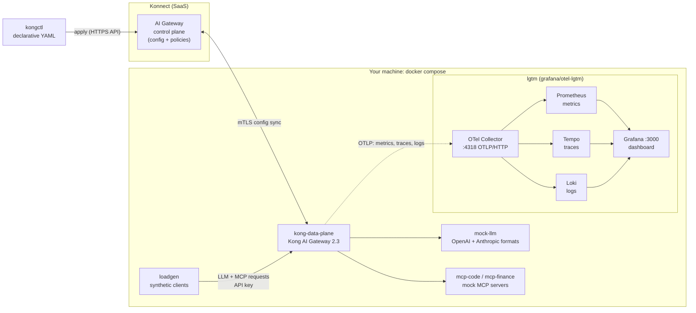
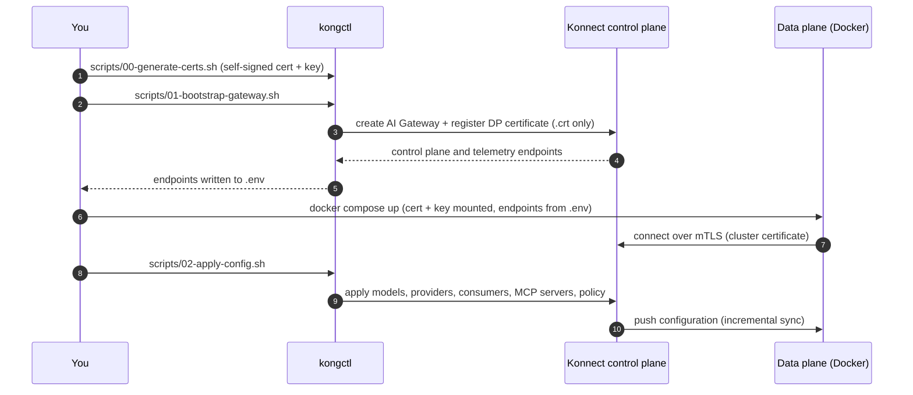
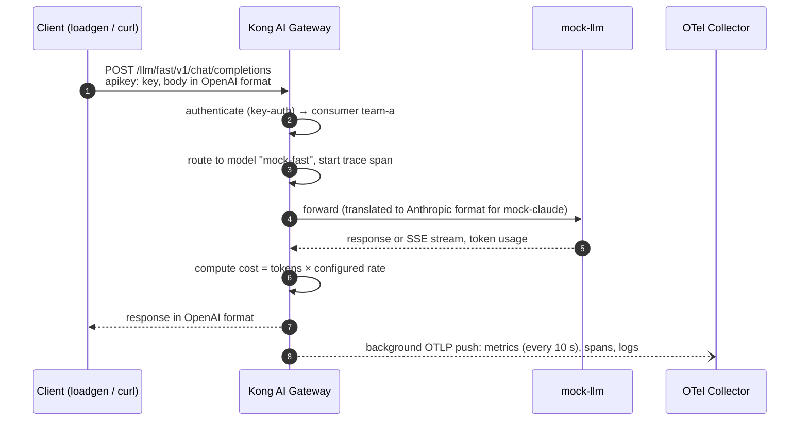
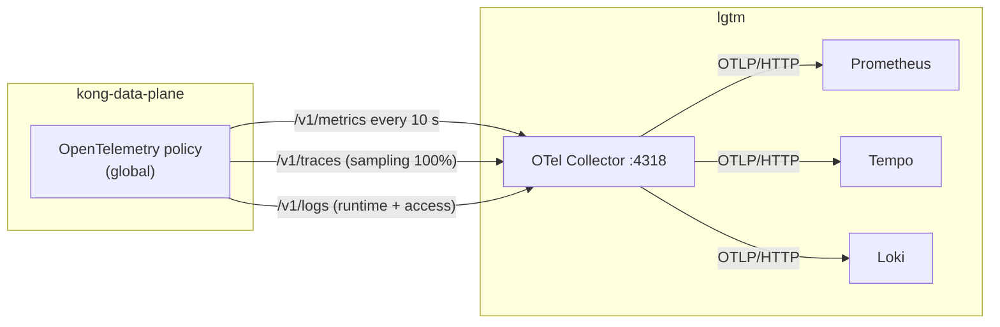
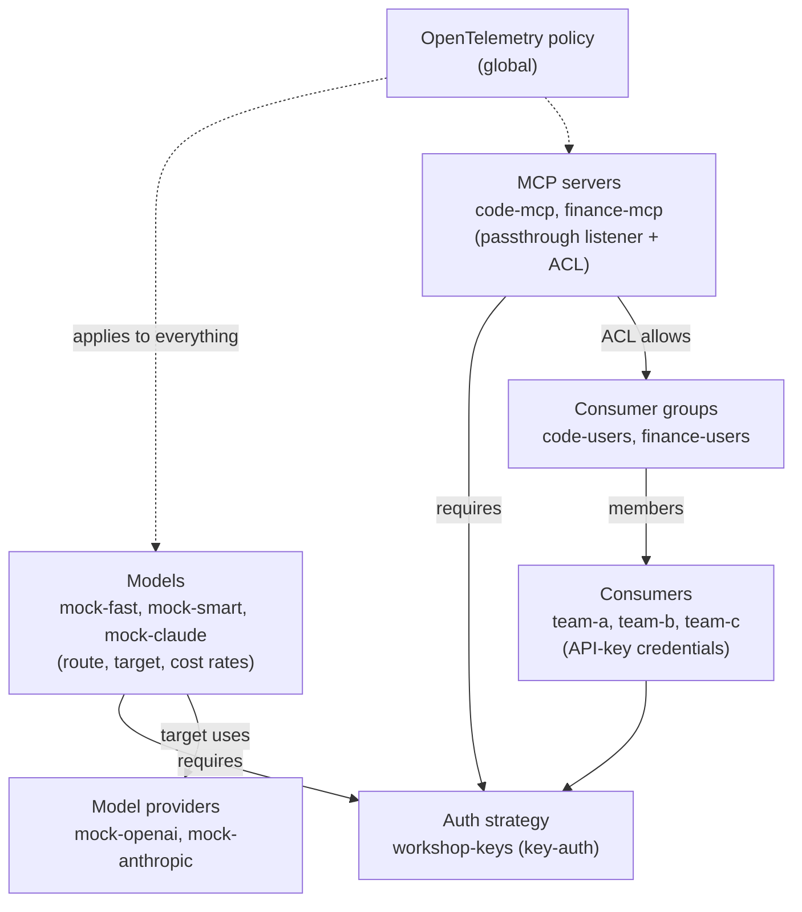

# Architecture

This document explains how the workshop is put together, how a request and its telemetry move through it, and which
parts are real and which are simulated. Read it before the labs in the [README](../README.md), or use it as a reference
while you work through them.

Contents: [1. Overview](#1-overview) · [2. Components](#2-components) · [3. Control plane and data plane](#3-control-plane-and-data-plane) ·
[4. Request flow](#4-request-flow) · [5. Telemetry pipeline](#5-telemetry-pipeline) · [6. Configuration model](#6-configuration-model) ·
[7. The dashboard](#7-the-dashboard) · [8. Real and simulated](#8-real-and-simulated) · [9. Security notes](#9-security-notes) ·
[10. From workshop to production](#10-from-workshop-to-production)

## 1. Overview

The workshop shows how to observe a Kong AI Gateway. A **Konnect control plane** holds the configuration. A **Docker
data plane** runs Kong AI Gateway 2.3 and handles the traffic. One **OpenTelemetry policy** on the gateway exports
metrics, traces and logs to a **Grafana LGTM** stack, where a provisioned dashboard presents them.

Three flows run side by side. They are independent, which is the main idea to take away:

| Flow | Direction | Carries |
|---|---|---|
| **Configuration** | kongctl → Konnect → data plane | Models, providers, consumers, MCP servers, the OpenTelemetry policy |
| **Traffic** | client → data plane → LLM or MCP server | The LLM and MCP requests the gateway governs |
| **Telemetry** | data plane → OpenTelemetry Collector → Grafana | Metrics, traces and logs about that traffic |

## 2. Components

| Container | Image | Host port | Role |
|---|---|---|---|
| `kong-data-plane` | `kong/kong-ai-gateway:2.3.0` | 18000 → 8000 | Kong AI Gateway data plane. Receives client traffic, applies policies, proxies upstream, exports telemetry |
| `lgtm` | `grafana/otel-lgtm:latest` | 3000 (Grafana), 4318 (OTLP/HTTP) | All-in-one Grafana stack: OpenTelemetry Collector, Prometheus (metrics), Tempo (traces), Loki (logs), Grafana. The image uses Prometheus where a full LGTM deployment would use Mimir |
| `mock-llm` | built from `backends/llm-mock` | none | Stand-in LLM provider. Speaks OpenAI chat completions and the Anthropic messages API, with streaming, random latency and injected errors |
| `mcp-code`, `mcp-finance` | built from `backends/mcp-mock` | none | Two stand-in MCP servers (Streamable HTTP) with a few tools each, one flaky and one slow |
| `loadgen` | built from `loadgen` | none | Traffic generator (profile `traffic`): three consumers, three models, streaming and non-streaming, MCP calls, a trickle of bad keys |

Outside Docker: **`kongctl`** (runs on your machine and talks to the Konnect API) and **Konnect**, which hosts the control plane.

All containers share one Docker network, `lab`, and reach each other by service name (for example `http://lgtm:4318`,
`http://mock-llm:4010`). Only the gateway, Grafana and the OTLP port are published to the host.

## 3. Control plane and data plane

Kong AI Gateway uses a **hybrid** deployment: the configuration lives in Konnect and the traffic runs on your own infrastructure.

Points worth knowing:

- **The data plane authenticates to Konnect with a client certificate.** Only the public certificate is uploaded; the private key never leaves `certs/` (which is gitignored).
- **The data plane holds no database** (`KONG_DATABASE=off`). It receives its configuration from Konnect and keeps it in memory.
- **The control plane is created by kongctl, not by hand.** `kongctl/00-ai-gateway.yaml` declares the gateway and certificate, and kongctl labels everything it creates with the namespace `kong-aigw-observability`, and `scripts/99-teardown.sh` deletes only the gateway with that name.
- **Two kongctl files, two lifecycles.** `00-ai-gateway.yaml` creates the gateway once. `01-config.yaml` is the part you change and re-apply: `kongctl plan` previews a change, `kongctl apply` makes it, and a second plan reports `total_changes: 0` when nothing has drifted.
- **Secrets are write-only.** Consumer API keys and the provider credential are sent to Konnect with `!secret` and cannot be read back. The generated values are kept in the local, gitignored `.env`.

## 4. Request flow

An LLM request through the gateway:

What the gateway does on the way:

- **Authenticates** the caller with an API key and resolves it to an **AI consumer** (`team-a`, `team-b`, `team-c`). The consumer name becomes a metric label.
- **Routes** by path (`/llm/fast/v1`, `/llm/smart/v1`, `/llm/claude/v1`) to an **AI model**, which maps to a provider target.
- **Translates formats.** Clients always speak the OpenAI format. For `mock-claude` the gateway converts to and from the Anthropic format, so one client works with both providers.
- **Meters.** It reads token usage from the response and multiplies it by the per-model `input_cost` and `output_cost` to produce a cost.
- **Exports telemetry in the background.** The OpenTelemetry policy queues and batches telemetry (see `queue` in the policy) and pushes it separately from the client response; metrics are pushed every 10 seconds.

MCP requests follow the same pattern. Each MCP server is exposed at a path (`/mcp/code`, `/mcp/finance`) in
`passthrough-listener` mode: the gateway authenticates the caller, applies the server's ACL, proxies the JSON-RPC call
and records MCP metrics. ACLs are evaluated against **consumer groups**: `team-c` is not in `finance-users`, so it receives
a 403 on `/mcp/finance`.

## 5. Telemetry pipeline

One **global OpenTelemetry policy** (`ai_gateway_policies` in `kongctl/01-config.yaml`) turns on all three signals.

| Signal | Policy settings | Backend | What you get |
|---|---|---|---|
| **Metrics** | `metrics.endpoint`, `push_interval: 10`, `enable_ai_metrics`, `enable_latency_metrics`, `enable_request_metrics`, `enable_bandwidth_metrics`, `enable_consumer_attribute` | Prometheus (via its OTLP endpoint) | `gen_ai.*` token, latency and cost metrics, MCP metrics, HTTP request metrics, Kong latency and health metrics |
| **Traces** | `traces_endpoint`, `sampling_rate: 1` | Tempo | A `kong` request span with a `chat <model>` child span carrying `gen_ai.*` attributes (model, provider, token counts, finish reason) |
| **Logs** | `logs_endpoint`, `access_logs.endpoint` | Loki | Runtime (error log) records, plus access-log records for responses the gateway itself produces |

Each metrics flag unlocks something specific. `enable_ai_metrics` switches on every `gen_ai.*` metric.
`enable_latency_metrics` is required for the request-duration metric. `enable_request_metrics` is required for the `error.type`
attribute, which every error panel depends on. `enable_consumer_attribute` adds the consumer name, which the per-user panels depend on.

All telemetry carries the resource attributes `service.name=kong-ai-gateway` and `deployment.environment=workshop`,
which is how you filter this gateway in a shared backend.

**Name mapping.** OpenTelemetry names become Prometheus names by replacing dots with underscores and adding a unit or type suffix:

| OpenTelemetry | Prometheus |
|---|---|
| `gen_ai.client.token.usage` (sum) | `gen_ai_client_token_usage_total` |
| `gen_ai.server.request.duration` (histogram) | `gen_ai_server_request_duration_seconds_bucket / _count / _sum` |
| `kong.gen_ai.llm.cost` (sum) | `kong_gen_ai_llm_cost_total` |
| `mcp.server.operation.duration` (histogram) | `mcp_server_operation_duration_seconds_*` |
| attribute `kong.auth.consumer.name` | label `kong_auth_consumer_name` |

Cost is only produced when a model target has `input_cost` and `output_cost` (dollars per million tokens); the workshop
uses invented prices.

## 6. Configuration model

Everything the gateway does is declared in `kongctl/01-config.yaml`. The objects and how they connect:

| Object | Count | Purpose |
|---|---|---|
| Auth strategy | 1 | API-key authentication, `apikey` header |
| Consumers | 3 | The callers. Their names appear in metrics and dashboards |
| Consumer groups | 2 | Membership used by the MCP server ACLs |
| Model providers | 2 | One OpenAI-type, one Anthropic-type, both served by `mock-llm` |
| Models | 3 | Each has a route path, a provider target and cost rates |
| MCP servers | 2 | `passthrough-listener` entries with ACLs |
| Policy | 1 | The global OpenTelemetry policy |

## 7. The dashboard

The dashboard is **generated code**, not hand-drawn JSON. `grafana/build_dashboard.py` writes
`grafana/dashboards/kong-ai-gateway.json`, and Grafana loads that file automatically at startup through file provisioning
(`grafana/provisioning/dashboards.yaml`), so there is nothing to import. Edit the script, run it, and Grafana picks up the change within about 10 seconds.

Its layout follows the Konnect AI Manager overview page, with two additional rows:

| Row | Source of data | Notes |
|---|---|---|
| Key metrics, Top consumers, Performance, Costs, Models | Prometheus | Same sections as the Konnect overview. Tiles compare the selected range with the previous range of equal length |
| MCP | Prometheus | Top MCP servers, calls by tool, failing calls, latency, response size |
| Gateway health | Prometheus | HTTP status codes, Kong latency split (total / internal / upstream), control plane connection, certificate expiry |
| Traces and logs | Tempo, Loki | Recent traces, error access logs, log volume, runtime logs |

Query patterns you will see when you open a panel:

- **Totals over the selected range:** `sum(increase(metric[$__range]))`
- **Rates over time:** `sum by (label)(rate(metric[$__rate_interval]))`
- **Percentiles:** `histogram_quantile(0.95, sum by (le)(rate(metric_bucket[$__rate_interval])))`
- **Error rate:** requests with a non-empty `error_type` divided by all requests
- **Previous period:** the same query with `offset $__range`
- **Filters:** the Providers, AI Gateway models and Consumers variables at the top are applied to every panel through label matchers

`scripts/validate-dashboard.py` runs every panel query against the live datasources and reports errors and empty panels, so a change to the dashboard can be checked without opening a browser.

## 8. Real and simulated

| Real | Simulated |
|---|---|
| Konnect control plane and the kongctl workflow | The LLM provider (`mock-llm` returns canned text) |
| Kong AI Gateway 2.3 data plane, auth, routing, format translation | Token counts (estimated from text length) |
| The OpenTelemetry policy and the OTLP export | Latency, time-to-first-token and per-token timing (random sleeps) |
| The LGTM stack, the dashboard and every query | Errors (about 4% injected, plus `RATE_LIMIT` and `SLOW` prompt markers) |
| Gateway-side measurements: counts, status codes, Kong latency, 401/403 responses | Traffic (`loadgen`) and the three "teams" |
| | Prices (invented rates), so dollar amounts have no meaning |
| | MCP servers (`mcp-mock` tools return fixed text) |

The gateway-side telemetry is genuine. The numbers that depend on a model's behaviour (tokens, latency, errors) are driven by the mock.
To use the dashboard against a real provider, change the target `upstream_url` and credentials in
`kongctl/01-config.yaml` and set real prices; the dashboard needs no changes.

## 9. Security notes

This is a **lab**. Several settings are deliberately relaxed and must not be copied into a real environment:

| Setting | Workshop value | Why it is fine here, and what to do instead |
|---|---|---|
| Grafana access | No login: anonymous users are Admin (the `grafana/otel-lgtm` default) | Local only. Use SSO and real roles |
| Telemetry transport | Plain HTTP between the gateway and the collector, inside one Docker network | Use TLS (and `client_certificate` or headers for authentication) across hosts |
| Data plane certificate | Self-signed, 365 days | Use your private CA and a rotation process |
| Credentials | Generated API keys and a fixed mock-provider key in the local `.env` (gitignored) | Use a secret store; do not keep keys in files |
| Prompts and completions | Not exported (`logging.payloads: false`) | Keep it that way unless you have reviewed redaction. `gen_ai.input.messages` and `gen_ai.output.messages` can contain personal data and secrets |
| Cardinality | Few consumers and models | Consumer, model and tool labels multiply series. Review them before adding more attributes |

## 10. From workshop to production

The workshop is a single-machine teaching setup. The pieces map to production roughly as follows. This is general
guidance, not a validated reference design; check sizing and support details with your Kong contact.

| Workshop | A production deployment would typically use |
|---|---|
| Data plane in Docker | Data planes on your container platform (for example Kubernetes), several replicas across zones, deployed and upgraded through your own pipeline |
| `lgtm` all-in-one | Separate, scaled backends for metrics, traces and logs (Grafana's LGTM components or your existing platforms), reached through your OpenTelemetry Collector or Grafana Alloy |
| Gateway → backend directly | Gateway → collector (Alloy or the OpenTelemetry Collector), which then batches, filters, enriches and fans out to several destinations (for example a log archive or SIEM) |
| `sampling_rate: 1` | A sampling rate set by traffic volume and trace storage cost |
| `kongctl` run by hand | The same YAML applied from CI/CD after a `plan` review, one gateway per environment |
| Mock providers and MCP servers | Your real model providers and MCP servers, with credentials kept in a vault |
| Invented prices | Your contracted prices, so cost panels reflect real spend |
| API-key consumers | Your identity provider, so callers and teams come from the identity you already manage |

The OpenTelemetry policy, the metric names, the dashboard queries and the kongctl workflow carry over unchanged.
